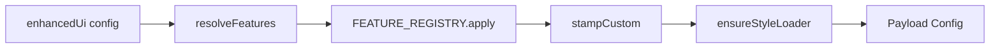

# @klnap/payload-enhanced-ui

Payload CMS 3 **admin UI enhancement plugin**: **configurable** admin improvements (shell styling, locale switcher, sidebar logo, checkbox-as-switch fields). **`enhancedUi()` turns all features on by default**; disable per key or category when you need stock behavior.

## Table of contents

1. [Purpose and scope](#purpose-and-scope)
2. [Getting started](#getting-started)
3. [Features](#features)
4. [Configuration reference](#configuration-reference)
5. [Admin UI: before and after](#admin-ui-before-and-after)
6. [Architecture and styling](#architecture-and-styling)
7. [API, exports, and troubleshooting](#api-exports-and-troubleshooting)
8. [Further reading](#further-reading)

---

## Purpose and scope

### Why install this

The default Payload 3 admin is fully functional but visually uniform. Teams often want:

- **Consistent shell polish** — scrollbars, header rhythm, breadcrumbs, sidebar typography, denser tables, clearer group headings, and calmer date/time pickers without maintaining dozens of one-off CSS overrides.
- **Better localized editing** — a dedicated header control for document locale instead of juggling the stock localizer layout on complex headers.
- **Sidebar branding** — the host’s Payload `Logo` anchored above navigation with a clear separator.
- **Clearer boolean fields** — checkbox config rendered as switch controls while keeping the same field type and API.

`@klnap/payload-enhanced-ui` packages those improvements behind **feature flags** with sensible defaults (everything on unless you opt out).

### What this plugin is not

| In scope | Out of scope |
| -------- | ------------ |
| Admin **appearance** and selected **field widgets** | Authentication, sessions, or RBAC (`@klnap/payload-iam`) |
| Payload `plugins[]`, `admin.components`, field `admin.components.Field` | Database schema, REST endpoints, jobs, or content models |
| CSS + a few import-map components | Replacing the admin app, routes, or document editor |
| Live Preview **split-pane layout CSS** | Live Preview URL, iframe URL, or **breakpoint** behavior (use `@klnap/draft` / host `admin.livePreview`) |

### Audience and relationship to Payload

**Who:** developers shipping Payload 3 + Next.js who want a cohesive admin look with minimal custom CSS.

**How it fits:** Payload still owns collections, globals, auth (unless another plugin replaces it), API routes, and editing UX. This plugin **layers** styling and slots components into Payload’s extension points. You keep upgrading Payload; you toggle or disable features if a Payload UI change conflicts.

---

## Getting started

Legend: **Required** · *Optional* · *Conditional*

### 1. Prerequisites — **Required**

| Requirement | Detail |
| ----------- | ------ |
| **Node** | `^24.0.0` (`engines`) |
| **Payload** | `^3.90.2` (peer; tested on `3.90.2`) |
| **`@payloadcms/ui`** | `^3.90.2` (peer) |
| **React / React DOM** | `^19.0.0` (peers — single copy in the host) |
| **Bundler** | Host app bundler must resolve this package’s `exports` (TypeScript sources when installed via `file:`) |

**Bun** `>=1.4.0` is used for package scripts in this repo; it is **not** a runtime peer.

**Dependencies installed with the package:** `@base-ui/react`, `tailwind-variants` — listed in `dependencies`, not peers.

No plugin-specific environment variables.

### 2. Minimal Payload configuration — **Required**

```ts
import { postgresAdapter } from '@payloadcms/db-postgres'
import { lexicalEditor } from '@payloadcms/richtext-lexical'
import { buildConfig } from 'payload'
import { enhancedUi } from '@klnap/payload-enhanced-ui'

export default buildConfig({
  secret: process.env.PAYLOAD_SECRET!,
  serverURL: process.env.SERVER_URL!,
  editor: lexicalEditor(),
  admin: {
    user: 'users',
    // sidebarLogo: set components.graphics.Logo (see below)
  },
  collections: [
    {
      slug: 'users',
      auth: true,
      fields: [{ name: 'email', type: 'email', required: true }],
    },
    /* …your content collections… */
  ],
  db: postgresAdapter({
    pool: { connectionString: process.env.DATABASE_URL! },
  }),
  plugins: [enhancedUi()],
})
```

Plugin order rarely matters (no owned collections). Defaults: **all admin features** and **`fields.checkboxUseSwitch`** are **on** unless you pass `admin: false`, `fields: false`, or per-key `false`.

### 4. Import map — **Required**

Payload resolves `@klnap/payload-enhanced-ui/…#Component` strings via your import map (e.g. `app/(payload)/admin/importMap.js`).

| Import map key | When the plugin registers it |
| -------------- | ----------------------------- |
| `@klnap/payload-enhanced-ui/client#EnhancedUiStyleLoader` | Any **enabled admin CSS feature** (see [style loader](#style-loader-and-peui-admincss)) |
| `@klnap/payload-enhanced-ui/rsc#LocaleSwitcher` | `localeSwitcher` on **and** `localization` configured |
| `@klnap/payload-enhanced-ui/admin/AdminNavLogo#default` | `sidebarLogo` on |
| `@klnap/payload-enhanced-ui/admin/CheckboxSwitchField#default` | `fields.checkboxUseSwitch` on |

Regenerate when supported:

```bash
bunx payload generate:importmap
```

Verify export names: `bun run check:exports` · [`scripts/exports-snapshot.json`](scripts/exports-snapshot.json).

The plugin wires **`client#EnhancedUiStyleLoader`**, not `rsc#`, for `afterNav`. The `./rsc` barrel also exports an RSC wrapper for manual registration.

`admin.user: 'users'` requires a **users** collection (or change `admin.user` to match your auth collection).

### 5. CSS integration — **Required**

When **any admin CSS feature** is enabled, the plugin **always** registers **`client#EnhancedUiStyleLoader`** on `admin.components.afterNav` ([`ensureStyleLoader`](src/plugin/enhanced-ui-plugin.ts)). That loader imports the aggregated **`peui-admin.css`**. This is automatic — not something you turn on separately.

**Recommended for production:** also **SSR-import** the same CSS in your admin root layout so shell rules apply on **first paint** (the loader runs after hydration and can flash unstyled chrome if it is your only source).

| Layer | What to do |
| ----- | ---------- |
| **Shell CSS (always needed in the browser)** | Provided via the plugin loader and/or your layout: `@klnap/payload-enhanced-ui/styles/peui-admin.css` |
| **SSR layout (recommended)** | `import '@klnap/payload-enhanced-ui/styles/peui-admin.css'` in `app/(payload)/layout.tsx` — complements the auto-registered loader |
| **Component chrome** | Locale switcher + switches need Tailwind utilities: import `@klnap/payload-enhanced-ui/styles/enhanced-tailwind.css` **or** compile with `@import` `styles/entry.css` and `@source` on `…/components/**/*.{ts,tsx}` |

You can SSR-import **`peui-admin.css`** and still keep the plugin loader — duplicate import of the same CSS file is harmless; many hosts use **both** for first paint + loader safety.

**Feature toggles vs CSS file:** disabling a feature in `enhancedUi({ … })` stops its **Payload config changes** (components, field mapping). It does **not** remove that feature’s rules from **`peui-admin.css`**. While **any** admin CSS feature in [`needsStyleLoader`](src/plugin/resolve-features.ts) stays **on**, the plugin registers **`EnhancedUiStyleLoader`**, which always imports the **full** aggregate — there is no built-in subset bundle. The loader is **not** registered only when **all** of those admin CSS features are off (`needsStyleLoader` false). Per-feature `./features/*/styles.css` exports exist for advanced host-owned setups; they are **not** a way to trim CSS while leaving plugin admin CSS features enabled.

See [Style loader and `peui-admin.css`](#style-loader-and-peui-admincss).

### 6. Host setup for specific features — *Conditional*

| Feature | Host must provide |
| ------- | ----------------- |
| **`localeSwitcher`** | `localization` with at least one locale. Without it, the plugin does **not** add `LocaleSwitcher` to `admin.components.actions`. |
| **`sidebarLogo`** | `admin.components.graphics.Logo` (server component compatible with `RenderServerComponent`). Without it, the slot renders empty; separator CSS may still show. |
| **`livePreviewLayout`** | Live Preview enabled on a collection; only affects UI when Payload sets `collection-edit--is-live-previewing`. |

### 7. Verification and pitfalls — **Recommended**

1. Open `/admin` — no import-map console errors.
2. With defaults: thinner scrollbars, header spacing, sidebar nav styling, styled breadcrumbs on edit views.
3. Localized site: custom locale control in header; stock `.app-header__localizer` hidden when locale CSS is loaded and switcher is present.
4. Checkbox fields render as switches when Tailwind utilities are available.
5. Package checks: `bun run check:exports` · `bun test` · [specs/manual-verification-matrix.md](specs/manual-verification-matrix.md).

**Common pitfalls:** missing import-map keys; `peui-admin.css` without `enhanced-tailwind.css` (unstyled switcher menu); enabling `localeSwitcher` without `localization`; expecting preview breakpoints from this package.

---

## Features

The plugin exposes **11 registered features** (`FEATURE_REGISTRY`): 10 under `admin.*` and 1 under `fields.*`. Each row below matches a registry entry.

Toggle resolution: `resolveFeatures()` in [`src/plugin/resolve-features.ts`](src/plugin/resolve-features.ts). Unless `admin: false` or `fields: false`, omitted keys default to **on**.

### Feature toggles (global)

| Control | Default | Effect |
| ------- | ------- | ------ |
| `enabled: false` | plugin on | **No-op** — config unchanged |
| `admin: false` | admin on | All `admin.*` features off |
| `fields: false` | fields on | `fields.checkboxUseSwitch` off |
| Per-key `false` or `{ enabled: false }` | on | That feature off |

**Config vs aggregated CSS:** toggles control **`FEATURE_REGISTRY.apply()`** (components, field overrides) and whether **`ensureStyleLoader`** runs (only when at least one admin CSS feature in `needsStyleLoader` stays on). They do **not** change which rules are inside **`peui-admin.css`**. When the loader runs, it always pulls the **full** file.

`localeSwitcher` also accepts `LocaleSwitcherOptions` (circle flags) — see [Configuration reference](#configuration-reference).

---

### Admin shell and visual styling (CSS-only)

These use `defineAdminCssFeature`: **`apply()` does not mutate config**; rules ship in `features/<name>/styles.css` and in the aggregated `peui-admin.css`. When any admin CSS feature stays enabled, the plugin **registers** **`EnhancedUiStyleLoader`** (in addition to any SSR import you add).

#### `scrollbarStyling` (`admin.scrollbarStyling`)

| Property | Details |
| -------- | ------- |
| **Purpose** | Thin, theme-aware scrollbars across admin chrome |
| **Visible change** | 6px scrollbars; thumb uses `--theme-elevation-*`; hides scrollbar buttons |
| **Default** | On |
| **Config** | `admin: { scrollbarStyling: false }` |
| **Host deps** | Load `peui-admin.css` (or style loader) |
| **Limits** | Global `html, html *` selectors — affects entire admin document |

#### `headerSpacing` (`admin.headerSpacing`)

| Property | Details |
| -------- | ------- |
| **Purpose** | More vertical room below the top app header |
| **Visible change** | `.app-header { margin-bottom: 3rem; }` |
| **Default** | On |
| **Config** | `admin: { headerSpacing: false }` |

#### `breadcrumbs` (`admin.breadcrumbs`)

| Property | Details |
| -------- | ------- |
| **Purpose** | Clearer step / breadcrumb trail in the header |
| **Visible change** | Larger `.step-nav` type; home icon replaced by **“Start”** text; long labels not truncated; **hidden below 1024px** with stock step-nav wrapper |
| **Default** | On |
| **Config** | `admin: { breadcrumbs: false }` |
| **Limits** | Mobile hides breadcrumbs entirely (by design in feature CSS) |

#### `sidebarNavStyling` (`admin.sidebarNavStyling`)

| Property | Details |
| -------- | ------- |
| **Purpose** | Readable sidebar navigation and scrollable nav area |
| **Visible change** | Larger `.nav__link` / group toggle type; `.nav__wrap` scrolls vertically with stable scrollbar gutter; extra group spacing |
| **Default** | On |
| **Config** | `admin: { sidebarNavStyling: false }` |

#### `fieldGroupTitles` (`admin.fieldGroupTitles`)

| Property | Details |
| -------- | ------- |
| **Purpose** | Stronger group field headings in the editor |
| **Visible change** | `.group-field__title` at `1.3rem`; extra header margin |
| **Default** | On |
| **Config** | `admin: { fieldGroupTitles: false }` |

#### `collectionListTableScroll` (`admin.collectionListTableScroll`)

| Property | Details |
| -------- | ------- |
| **Purpose** | Wide collection lists and version tables without squashing columns |
| **Visible change** | Full-width list/versions wrappers; horizontal scroll in table scrollport; **nowrap** cells |
| **Default** | On |
| **Config** | `admin: { collectionListTableScroll: false }` |
| **Limits** | CSS also targets embedded role-user tables (`.collection-edit--roles .iam-role-users-embedded`) when present |

#### `dateTimePickerStyling` (`admin.dateTimePickerStyling`)

| Property | Details |
| -------- | ------- |
| **Purpose** | Easier date/time selection in popups |
| **Visible change** | Larger day cells (CSS variables `--peui-dp-*`); taller time list; sans-serif time labels; adjusted mobile time list height |
| **Default** | On |
| **Config** | `admin: { dateTimePickerStyling: false }` |

#### `livePreviewLayout` (`admin.livePreviewLayout`)

| Property | Details |
| -------- | ------- |
| **Purpose** | Calmer split-pane layout while Live Preview is open |
| **Visible change** | When `.collection-edit--is-live-previewing`: vertical divider on preview pane; doc controls bar full width; **~40%** width field column; full-width fields/sidebar stack; tab/group full-bleed rules; stable scrollbar gutter on `html` |
| **Default** | On |
| **Config** | `admin: { livePreviewLayout: false }` |
| **Not included** | Preview URL, iframe src, device breakpoints, or `@klnap/draft` integration — layout CSS only ([ADR 0001](./docs/adr/0001-scope.md)) |

---

### Locale switcher (`admin.localeSwitcher`)

| Property | Details |
| -------- | ------- |
| **Purpose** | Fast document locale changes from the app header |
| **Visible change** | Custom dropdown (`peui-locale-switcher`) in `admin.components.actions`; stock **`.app-header__localizer`** hidden via feature CSS; header action alignment adjusted on list/edit views |
| **Default** | On |
| **Config** | `admin: { localeSwitcher: false }` or `LocaleSwitcherOptions` (below) |
| **Host deps** | **`localization`** required to register the component; logged-in **`user`** (RSC returns `null` for guests); **`enhanced-tailwind.css`** or `@source` for menu/trigger styling |
| **Behavior** | Client menu (Base UI **Menu**, not Payload Popup). Locale change sets **`?locale=`** on the current path ([`buildLocaleUrl`](src/components/locale-switcher/locale-switcher.tsx)). Uses Payload `useLocale`, `useRouteTransition`, and locale loading blur overlay |
| **Circle flags** | Optional [circle-flags](https://github.com/HatScripts/circle-flags) SVGs; default CDN `https://hatscripts.github.io/circle-flags`; built-in locale→flag map in [`circle-flags.ts`](src/components/locale-switcher/circle-flags.ts); override via `flagCodeByLocale` stored on `config.custom.enhancedUi` |
| **Limits** | If `localeSwitcher` is on and **`peui-admin.css`** is loaded but **`localization` is missing**, localizer-hide CSS can still apply without a replacement control — disable the feature or add localization |

**Circle flags example:**

```ts
enhancedUi({
  admin: {
    localeSwitcher: {
      circleFlags: {
        flagCodeByLocale: { en: 'gb', pl: 'pl' },
        // baseUrl: 'https://your-cdn.example/flags',
      },
    },
  },
})
```

Set `circleFlags: false` on the locale switcher object to disable icons.

---

### Sidebar logo (`admin.sidebarLogo`)

| Property | Details |
| -------- | ------- |
| **Purpose** | Brand mark above sidebar links |
| **Visible change** | `AdminNavLogo` in `admin.components.beforeNav` wraps host **`graphics.Logo`** in `peui-sidebar-logo-header` with separator line (`::after`) |
| **Default** | On |
| **Config** | `admin: { sidebarLogo: false }` |
| **Host deps** | `admin.components.graphics.Logo` — rendered via `RenderServerComponent` with `clientProps: { variant: 'nav' }` |
| **If no Logo** | Empty header region; separator styling may still appear |

---

### Checkbox fields as switches (`fields.checkboxUseSwitch`)

| Property | Details |
| -------- | ------- |
| **Purpose** | Boolean fields read as modern toggles |
| **Visible change** | Checkbox fields use **`CheckboxSwitchField`** (Base UI switch, `peui-switch` layout) |
| **Default** | On |
| **Config** | `fields: { checkboxUseSwitch: false }` or `fields: false` |
| **Scope** | All **collections** and **globals**; walks **tabs**, **groups**, **rows**, **arrays**, **collapsibles**, and **blocks** recursively ([`map-checkbox-fields.ts`](src/features/checkbox-use-switch/map-checkbox-fields.ts)) |
| **Skips** | Checkbox fields that already define `admin.components.Field` |
| **Styles** | Switch **chrome** uses Tailwind in TSX — requires **`enhanced-tailwind.css`** or host `@source` on plugin components; **`peui-admin.css`** alone is insufficient for switch/menu chrome |
| **Limits** | Does **not** trigger `EnhancedUiStyleLoader` by itself (no `admin.*` CSS feature); does not change field type, validation, or API |

---

### Removed in 0.2.0 (migration)

| Removed key | Replacement |
| ----------- | ----------- |
| `livePreviewStyling` | `livePreviewLayout` + `@klnap/draft` for breakpoints |
| `savePublishMenuStyling` | Stock Payload save/publish menu or host CSS |

---

## Configuration reference

Public API: **`enhancedUi(userConfig?)`** · types **`EnhancedUiConfig`**, **`FeatureToggle`**, **`AdminFeatureKey`**, **`LocaleSwitcherOptions`** exported from `@klnap/payload-enhanced-ui` ([`src/features/types.ts`](src/features/types.ts)).

### `EnhancedUiConfig`

| Property | Type | Default | Resolution |
| -------- | ---- | ------- | ---------- |
| `enabled` | `boolean` | `true` | `false` → plugin returns incoming config unchanged |
| `admin` | `false` or `{ … }` | all admin keys **on** | `false` → every `admin.*` id false |
| `fields` | `false` or `{ checkboxUseSwitch? }` | switch **on** | `false` → `fields.checkboxUseSwitch` false |

**Toggle forms:** `true` | `false` | `{ enabled?: boolean }`. For `localeSwitcher` only, you may pass **`LocaleSwitcherOptions`** (`enabled?`, `circleFlags?`).

**Internal (not host config):** feature modules only reference components via import-map strings. Runtime stamp: **`config.custom.enhancedUi`** includes `resolved` feature booleans and `localeSwitcher.circleFlags` ([`enhanced-ui-custom.ts`](src/integration/enhanced-ui-custom.ts)). There is no public export for reading it from `@klnap/payload-enhanced-ui` — use Payload config at runtime if needed.

### Examples

**Defaults (all features on):**

```ts
enhancedUi()
// equivalent to enhancedUi({}) with admin and fields omitted
```

**Disable one admin feature:**

```ts
enhancedUi({
  admin: {
    dateTimePickerStyling: false,
    livePreviewLayout: false,
  },
})
```

**Disable all admin styling/components; keep switches:**

```ts
enhancedUi({
  admin: false,
  fields: { checkboxUseSwitch: true },
})
```

**Disable switches only:**

```ts
enhancedUi({
  fields: { checkboxUseSwitch: false },
})
```

**Locale switcher + flags:**

```ts
enhancedUi({
  admin: {
    localeSwitcher: {
      enabled: true,
      circleFlags: {
        enabled: true,
        baseUrl: 'https://hatscripts.github.io/circle-flags',
        flagCodeByLocale: { de: 'de', 'en-US': 'us' },
      },
    },
  },
})
```

**Master off:**

```ts
enhancedUi({ enabled: false })
```

---

## Admin UI: before and after

Installing **`enhancedUi()`** does **not** replace the Payload admin application. Routes, APIs, collection slugs, Lexical, versions, and save/publish logic remain Payload’s unless other plugins change them.

### Change types

| Type | Features |
| ---- | -------- |
| **CSS-only** | scrollbars, header spacing, breadcrumbs, sidebar nav, field group titles, list/version tables, date/time picker, live preview layout |
| **Component slot** | locale switcher (`actions`), sidebar logo (`beforeNav`), style loader (`afterNav`) |
| **Hidden stock UI** | `.app-header__localizer` when locale feature CSS is active |
| **Field override** | checkbox → switch |
| **Unchanged** | Auth (unless `@klnap/payload-iam`), RBAC, default nav groups, save/publish menu (since 0.2.0), data behavior |

### Comparison table (defaults on)

Assume admin route `/admin`.

| Area | Stock Payload | With `@klnap/payload-enhanced-ui` |
| ---- | ------------- | --------------------------------- |
| Scrollbars | Browser default | Thin themed scrollbars |
| Header | Default spacing | Extra margin below header bar |
| Step nav / breadcrumbs | Default | “Start” label, larger type; hidden on small viewports |
| Sidebar | Default nav | Larger links; scrollable `.nav__wrap`; optional logo block + line |
| Document locale | Stock localizer | Custom dropdown (`?locale=`); stock localizer hidden when switcher CSS active |
| Collection / versions lists | Default table layout | Full width, nowrap, horizontal scroll |
| Group fields | Default labels | Larger group titles |
| Date/time popup | Default density | Larger cells and time list |
| Live Preview split | Default | Divider, 40% field column, full-width fields, doc controls alignment |
| Checkbox fields | Checkbox control | Switch UI |
| Save/publish menu | Stock | Unchanged by this package |

Disabling **`enabled`**, **`admin: false`**, or individual keys reverts **runtime behavior** (components, field mapping, loader when no admin CSS features remain). Importing the full **`peui-admin.css`** still applies **every rule in the bundle** regardless of toggles — see [CSS integration](#5-css-integration--required).

---

## Architecture and styling

### Plugin pipeline



1. **`resolveFeatures`** — boolean map for each `admin.*` / `fields.*` id.
2. **`FEATURE_REGISTRY.reduce`** — enabled features run **`apply({ incoming, resolved })`**.
3. **`stampCustom`** — merges **`custom.enhancedUi`** (resolved flags + locale flag options).
4. **`ensureStyleLoader`** — if **`needsStyleLoader(resolved)`** (any enabled admin CSS feature from the list in `resolve-features.ts`), prepends **`@klnap/payload-enhanced-ui/client#EnhancedUiStyleLoader`** to **`admin.components.afterNav`**.

Feature types: CSS-only (`defineAdminCssFeature`), config mutators (locale switcher, sidebar logo), field mapper (checkbox switch). Details: [docs/architecture.md](./docs/architecture.md).

### Style loader and `peui-admin.css`

- **`ensureStyleLoader`** — when `needsStyleLoader(resolved)` is true, prepends **`client#EnhancedUiStyleLoader`** to `afterNav` (any enabled admin CSS feature).
- **`EnhancedUiStyleLoader`** — client component that imports **`peui-admin.css`** (the `./client` entry side-imports it as well).
- **`peui-admin.css`** — static `@import` chain of **all** feature `styles.css` files ([`src/styles/peui-admin.css`](src/styles/peui-admin.css)); not trimmed per host config.
- **SSR import** — optional but recommended for first paint; works **alongside** the auto-registered loader, not instead of it (unless all admin CSS features are off and the loader is not registered).
- **`./features/*/styles.css` exports** — same source files rolled into `peui-admin.css`; useful only in custom setups where the matching plugin admin features are **off** and you import CSS yourself (not while `EnhancedUiStyleLoader` is active).

### Tailwind / component CSS

- **`styles/entry.css`** — Tailwind v4 entry for hosts compiling utilities.
- **`styles/enhanced-tailwind.css`** — precompiled utilities for locale switcher and switch field (built in `build:dist` / `build:styles`).
- Component TSX uses **`tailwind-variants`**; literals must appear in source for `@source` scanning.

### Source vs `dist` consumers

When you install with `file:` pointing at this repository, `package.json` `exports` resolve to **`src/`** for TypeScript in the host bundler.

---

## API, exports, and troubleshooting

Verified against [`package.json`](package.json) exports and [`scripts/exports-snapshot.json`](scripts/exports-snapshot.json).

### JavaScript / components

| Import | Exports |
| ------ | ------- |
| `@klnap/payload-enhanced-ui` | `enhancedUi`; types `EnhancedUiConfig`, `EnhancedUiFeatureId`, `FeatureToggle` |
| `@klnap/payload-enhanced-ui/client` | `EnhancedUiStyleLoader`; types for locale switcher client props; side effect: `peui-admin.css` |
| `@klnap/payload-enhanced-ui/rsc` | `LocaleSwitcher`, `EnhancedUiStyleLoader` (RSC wrapper) |
| `@klnap/payload-enhanced-ui/admin/CheckboxSwitchField` | default field component |
| `@klnap/payload-enhanced-ui/admin/AdminNavLogo` | default sidebar logo slot |

### CSS entry points

| Import | Purpose |
| ------ | ------- |
| `@klnap/payload-enhanced-ui/styles/peui-admin.css` | Aggregated admin shell feature CSS |
| `@klnap/payload-enhanced-ui/styles/entry.css` | Tailwind v4 source entry |
| `@klnap/payload-enhanced-ui/styles/enhanced-tailwind.css` | Prebuilt utilities for components |
| `@klnap/payload-enhanced-ui/features/*/styles.css` | Per-feature source CSS (also aggregated into `peui-admin.css`; not a trim switch while the loader is on) |

### Troubleshooting

| Symptom | Likely cause | Fix |
| ------- | ------------- | --- |
| Import map error (`#LocaleSwitcher`, `#EnhancedUiStyleLoader`, …) | Stale map | Regenerate import map; match [Getting started §4](#4-import-map--required) |
| Locale switcher unstyled / plain menu | Missing Tailwind utilities | Add `enhanced-tailwind.css` or `@source` components |
| Stock localizer hidden, no custom switcher | `localeSwitcher` on, CSS loaded, **no** `localization` | Add localization or disable `localeSwitcher` |
| Empty sidebar logo area | No `graphics.Logo` | Set Logo or disable `sidebarLogo` |
| Checkboxes still stock | Custom `Field` set, or `fields` off | Remove override; enable `checkboxUseSwitch` |
| Shell CSS missing on first paint | Only client loader, slow hydration | SSR-import `peui-admin.css` in layout |
| Switches work, shell unchanged | Only Tailwind loaded | Import `peui-admin.css` |
| `check:component-exports` fails | Stale or missing export for a `#Component` path | Run `check:exports`; update host import map to match [Getting started §4](#4-import-map--required) |

---

## Further reading

| Document | Topic |
| -------- | ----- |
| [docs/architecture.md](./docs/architecture.md) | Package layout, boundaries, style modes |
| [docs/adr/0001-scope.md](./docs/adr/0001-scope.md) | Product boundary |
| [specs/manual-verification-matrix.md](./specs/manual-verification-matrix.md) | Manual QA matrix |
| [AGENTS.md](./AGENTS.md) | Maintainer scripts and conventions |

---

## License

MIT — see [LICENSE](./LICENSE).
